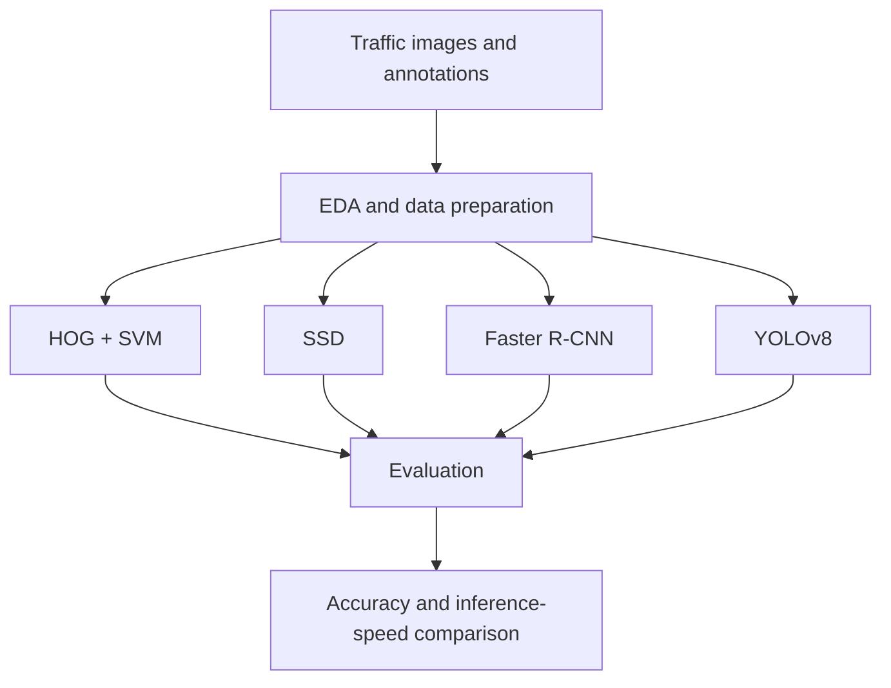

# Vehicle Detection Benchmark

A comparative computer vision study of classical and deep learning object detectors for identifying vehicles in traffic surveillance images.

**Best reported result:** 95.38% mAP@0.50 · 76.19% mAP@0.50:0.95 (YOLOv8)

**Stack:** Python · OpenCV · HOG/SVM · SSD · Faster R-CNN · YOLOv8 · Jupyter

## Overview

The project investigates accuracy and inference-speed trade-offs across four vehicle detection approaches, from handcrafted features to modern deep learning architectures. Given a traffic image, the output is a set of bounding boxes and vehicle class predictions.

## Dataset

The [Vehicle Detection Dataset](https://universe.roboflow.com/skripsi-1qzlz/vehicle-detection-bvxpr) on Roboflow contains approximately 1,000 traffic images collected from public traffic cameras in Yogyakarta, Indonesia. Annotations are provided in YOLO format for four classes: `car`, `motorbike`, `truck`, and `bus`.

## Methodology



| Method | Approach |
| --- | --- |
| HOG + SVM | Handcrafted gradient features, sliding windows and non-maximum suppression |
| SSD | Single-stage detector with multi-scale features and default boxes |
| Faster R-CNN | Two-stage detector with region proposals and bounding-box refinement |
| YOLOv8 | Anchor-free, single-stage deep learning detector |

## Experimental results

| Method | Precision | Recall | mAP@0.50 | mAP@0.50:0.95 | FPS |
| --- | ---: | ---: | ---: | ---: | ---: |
| HOG + SVM | 4.30% | 0.62% | 0.12% | 0.03% | 5.00 |
| SSD | 38.70% | 38.60% | 79.20% | 54.60% | 26.00 |
| Faster R-CNN | 39.62% | 39.81% | 91.79% | 67.43% | 12.21 |
| **YOLOv8** | **94.56%** | **90.72%** | **95.38%** | **76.19%** | **142.68** |

Values are the original team-reported experimental results, not newly reproduced measurements. YOLOv8 achieved the highest reported accuracy and throughput among the tested configurations. Faster R-CNN achieved strong mAP but lower reported throughput, while the handcrafted baseline performed poorly on this dataset.

FPS depends on hardware, image size, batch size, preprocessing and timing boundaries. Precision and recall can also depend on operating thresholds. The table should not be interpreted as a hardware-normalized benchmark until the evaluation protocols have been reconciled across implementations.

## Reproduce the experiments

Clone the repository and install the declared dependencies in a virtual environment:

```bash
git clone https://github.com/zaabinh/CS231-VehicleDetection.git
cd CS231-VehicleDetection
python -m venv .venv
source .venv/bin/activate  # Windows: .venv\Scripts\activate
pip install -r requirements.txt
```

Download the dataset from Roboflow, update notebook paths as needed and ensure the PyTorch/CUDA environment matches the selected runtime. Execute the notebooks for the desired method.

| Stage | Notebook |
| --- | --- |
| Dataset analysis | [EDA](notebooks/EDA_main.ipynb) |
| HOG + SVM | [Classical detector](notebooks/HOG_SVM/hog_svm_vehicle_detection.ipynb) |
| SSD | [SSD experiment](notebooks/SSD/SSD_main.ipynb) |
| Faster R-CNN | [Faster R-CNN experiment](notebooks/FasterRCNN/FasterRCNN_main.ipynb) |
| YOLOv8 | [With augmentation](notebooks/YOLOv8/yolov8_aug_main.ipynb) · [Without augmentation](notebooks/YOLOv8/yolov8_no_aug_main.ipynb) |
| Inference demonstration | [Deployment notebook](notebooks/deployment.ipynb) |

Model artifacts may require Git LFS or separate downloads; inspect the repository before running inference. The inference notebook is not evidence of a live deployed service.

## Limitations and future work

The study focuses on image-level detection rather than tracking identities across video frames. Future experiments should standardize inference hardware and timing, validate on independent traffic datasets and investigate difficult conditions such as occlusion, small objects and illumination changes.

## Contributors

Academic team project — CS231 Introduction to Computer Vision, University of Information Technology (VNU-HCM).

- Đoàn Hữu Gia Bình
- Phan Công Thiện
- Nguyễn Tấn Phát
- Nguyễn Trường Nguyên

Supervisor: Mai Tiến Dũng.
